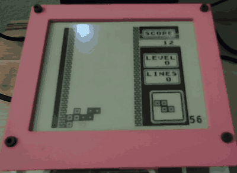

# gameboy-eink

Game Boy on a 4.2" e-ink display, using CircuitPython and the Peanut-GB emulator.

## Parts

- Adafruit Feather RP2040 ThinkInk
- Adafruit 4.2" SSD1683 e-ink display (#6381)
- Adafruit Mini I2C STEMMA QT Gamepad (#5743)

## Setup

1. Download the UF2 and zip from [Releases](https://github.com/mikeysklar/gameboy-eink/releases).
2. Hold BOOTSEL and press RESET, then copy the UF2 to the `RPI-RP2` drive.
3. Unzip the zip and copy its files to the `CIRCUITPY` drive.
4. Copy your own 32 KB Game Boy ROM to `CIRCUITPY` as `Tetris.gb`. No ROM is included.

## Controls

| Game Boy | Gamepad |
|---|---|
| D-pad | Joystick |
| A | A or X |
| B | B or Y |
| Start | Start |
| Select | Select |

Hold Select + Start for 1 second to exit.

## License

MIT, see [LICENSE](LICENSE). `src/peanut_gb_cgb.h` is Peanut-GB by Mahyar Koshkouei, also under the MIT License.
